<p align="center">
  
</p>

<p align="center">
  
  
  
  
</p>

BeatDrop is a DJ setup you play with your hands. A webcam tracks both hands, and you mix two
songs by scratching, changing tempo, crossfading and riding stem volumes in the air, with no
controller and no mouse during a set.

Built at DubHacks 2026.

## How it works

BeatDrop runs on two screens, both facing the DJ.

- **Decks screen (Monitor 1).** A traditional two-deck layout: track search, play and cue,
  scrolling waveforms, BPM, tempo faders, four stem faders per deck (vocals, drums, bass,
  instrumental) and a crossfader. This window runs the audio engine, so all the sound comes
  from here.
- **Camera screen (Monitor 2).** A mirrored webcam view with both hands tracked. Records, stem
  bars, a crossfader and tempo lines sit over the video, and you play them with gestures.

Both screens drive the same engine and stay in sync over a `BroadcastChannel`. A gesture and
a slider send the engine the exact same command, so moving a stem on the camera screen moves
its fader on the decks screen. Only one window ever plays audio.

Songs are split ahead of time into four aligned stems, so each part of a track can be
controlled on its own.

## Gestures

| Gesture | What it does |
| --- | --- |
| Pinch the top of a stem bar, slide up or down | Stem volume |
| Open palm on one side, turn it like a steering wheel | Scratch that side's deck (left = A, right = B) |
| Fist out to your side, move it up or down | Tempo of that side's deck |
| One or two fingers up, slide sideways | Crossfade |
| Let your fingers hang down together, raise your hand, then open it | Build-up, then the drop lands on the next beat |

The camera screen starts each session with a short gesture setup. You show five poses and
BeatDrop learns how your fist and lift pose look, so tempo and the drop work for your hand.
It can optionally use [Perceptron](#perceptron-optional) to check each demo.

## Setup

You need Node.js 20+ and a webcam. Chrome works best.

```sh
npm install
npm run dev
```

Then open two windows:

- Decks screen: https://beatdrop-web.onrender.com
- Camera screen: https://beatdrop-web.onrender.com/spatial.html

Move each window to its own monitor (the camera screen has a fullscreen button, or press F),
click **Start session** on the camera screen, and allow camera access.

The camera screen also works on its own. With no decks screen open it runs its own engine,
and it hands audio over to the decks screen as soon as one opens.

### Music

Songs live in `mp3/`, named `Artist - Title.mp3`. Their pre-split stems are committed in
`mp3/.stems/`, so a fresh clone is ready to play. To split new songs you need the Python stem
tools:

```sh
python3 -m venv .venv
.venv/bin/pip install -r tools/stems/requirements.txt

# Demucs needs torch; use Python 3.12 in its own environment
python3.12 -m venv .venv-demucs
.venv-demucs/bin/pip install -r tools/stems/requirements-demucs.txt

.venv/bin/python tools/stems/separation_server.py   # http://127.0.0.1:8765
```

With the server running, songs picked in the app are split on demand. A three-minute song
takes about 50 seconds on a laptop CPU. See [`tools/stems/README.md`](tools/stems/README.md)
for batch splitting and other options.

### Perceptron (optional)

During the gesture setup, BeatDrop can send each short demo to
Perceptron's Mk1.5 model, which finds the moments you
actually held the pose. BeatDrop then learns only from those moments. Without it, the setup
uses the whole demo.

1. Put `PERCEPTRON_API_KEY=...` in `.env.local` at the repo root. The file is git-ignored.
2. Start `tools/stems/separation_server.py` as above; it handles the Perceptron requests.
   The key stays in that local service and never reaches the browser.

Perceptron is only used during setup, never while you play.

### Deploying

`npm run build` then `npm run preview` serves the app. On hosts that set `PORT` (Render,
Railway) it listens publicly on that port. Stem splitting and Perceptron need the Python
service; if it runs somewhere other than this machine, set `VITE_SERVICE_URL` to its address
at build time.

## Keyboard

**Decks screen:** `[` `]` find a song · `Q` `P` play · `W` `O` stop · `A` `;` cue ·
`S` `L` skip · `E` `D` `I` `K` tempo · `1`–`4`, `7`–`0` mute stems · `R` record · `F` fullscreen

**Camera screen:** `/` search · `Space` play/pause · `A` `B` play a deck · `←` `→` crossfade ·
`F` fullscreen · `C` gesture setup · `Shift+C` reset it · `H` debug overlay

## Development

```sh
npm test            # unit tests (Vitest)
npm run typecheck
npm run build
```

| Path | What's there |
| --- | --- |
| `src/audio/` | Audio engine: two decks, stems, crossfader, tempo, loops, build and drop, scratch |
| `src/decks/` | Decks screen (React) |
| `src/perception/` | MediaPipe hand tracking and gesture detection |
| `src/ar/` | Camera screen: interaction logic and rendering |
| `src/spatial/` | Camera screen entry point and the gesture setup |
| `src/integration/` | Sync between the two windows |
| `src/stems/`, `tools/stems/` | Stem loading, splitting and the local service |
| `tools/perceptron/` | Perceptron requests for the gesture setup |
| `server/` | Music library routes on the Vite server |

More detail is in [`docs/audio-engine.md`](docs/audio-engine.md) and
[`docs/spatial-interaction.md`](docs/spatial-interaction.md).

## Team

- **Ruhi Gottumukkala**: hand tracking, gestures and the camera screen
- **Maia Womack**: decks screen and stems
- **Siyona Verma**: audio engine
